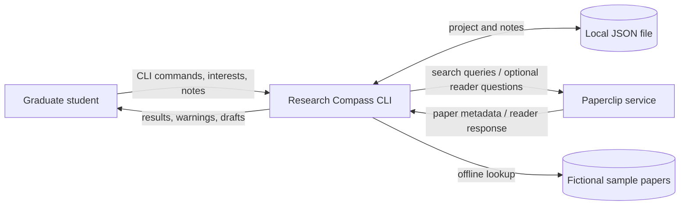
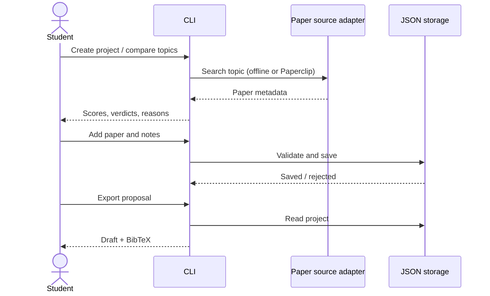

# Full Spec: Research Compass

**Team:** Zhang, Haoxuan; Byanjankar, Aayush; Rayamajhi, Dipesh; Ghimire, Sulav  **Date:** November 19, 2026  **Committer:** Byanjankar, Aayush (proposed; confirm before merge)

**Roles:** Product Owner **Zhang, Haoxuan** | Process lead **Byanjankar, Aayush** | Architect **Rayamajhi, Dipesh** | Quality lead **Ghimire, Sulav** | Prompt engineer **Byanjankar, Aayush (proposed)**

---

## 0. The idea (Chapter 1)  Owner: Zhang, Haoxuan
- **The single main problem, and for whom:** Research Compass helps graduate students turn a broad research interest into a defensible topic comparison, organized literature survey, and editable proposal skeleton.
- **Who is harmed if this app fails, is wrong, or leaks data?** The student could waste research time, select a poorly supported topic, cite incorrect information, or expose private research notes. Supervisors could receive misleading drafts.
- **Anything the app must never do:** Never present a generated proposal as verified scholarship; never silently overwrite valid notes after errors; never store API keys in the repository or project JSON; never send local notes to Paperclip; never fabricate citations; never make research judgments on the student's behalf.
- **AI contribution:** AI helped organize the problem and risks; the team must review and approve this framing.

## 1. Process and plan (Chapters 2 and 3)  Owner: Byanjankar, Aayush
- **Process model we chose and why:** Incremental development fits because the CLI, topic scoring, survey, and proposal modules can be built and tested independently. Short iterations let us demonstrate offline functionality before depending on the external Paperclip service.
- **Practices we actually use:** GitHub version control and automated pytest tests are documented. **Planned/to verify:** issue board, sprint reviews, pull-request review, and tests on every change; do not claim these occurred until confirmed.
- **Definition of Done:**
  - [ ] Behavior meets its acceptance criteria.
  - [ ] Automated tests include at least one successful and one invalid-input case.
  - [ ] Errors return code 1 and preserve the existing project JSON.
  - [ ] Feature works through the CLI in offline mode where applicable.
  - [ ] Documentation and review are complete; tests pass on the target environment.
- **Sprint plan** (proposed milestones, not a verified historical log):

| Sprint | Working software at the end | se-agent run? |
|---|---|---|
| 1 | CLI, project creation, JSON persistence, offline fixtures | Planned run 1 |
| 2 | Topic scoring, Paperclip adapter, search, survey and notes | Planned run 2 |
| 3 | Literature outputs, coverage checks, proposal/BibTeX, end-to-end tests | Planned run 3 |

- **Biggest schedule risk and mitigation:** Paperclip SDK installation/authentication and network behavior may delay live integration; keep the offline adapter working, mock the external API, and verify the live path separately.
- **AI contribution:** AI proposed sprint sequencing and DoD wording; actual sprint history and practices require team verification.

## 2. Requirements (Chapter 4)  Owner (Product Owner): Zhang, Haoxuan
**Stakeholders and what each wants:**

| Stakeholder | Wants |
|---|---|
| Graduate student | Understand topic options, organize papers, create a useful draft without programming expertise |
| Research supervisor | Traceable sources, clearly labeled gaps, and a draft the student can defend |
| Development team | Modular code, reproducible offline tests, clear acceptance checks |
| Course instructor | Evidence of requirements, design, testing, process, and justified tradeoffs |

**User stories** (with acceptance criteria):
1. As a student, I want to create a project from a name and interest so that I can save my work. **Accept:** a valid command creates one readable JSON project file.
2. As a student, I want to compare up to eight topics so that I can choose what to investigate. **Accept:** each topic gets a 0–100 score, verdict, and evidence; fewer than five papers is *too narrow* and at least 40% review titles is *saturated*.
3. As a student, I want to search and save papers so that I can build a survey. **Accept:** numbered search results allow valid selections; duplicates by ID, DOI, or title are skipped and reported.
4. As a student, I want to annotate papers and inspect coverage so that I can recognize weaknesses. **Accept:** relevance must be 1–5; outputs include a matrix, theme outline, reported gaps, and coverage warnings.
5. As a student, I want a proposal skeleton so that I can begin writing. **Accept:** draft contains required sections, author-year citations, TODOs for missing material, a timeline, and BibTeX.

**Requirements table:**

| ID | Type | Requirement (testable) | Priority | Acceptance test (input -> expected result) |
|---|---|---|---|---|
| R1 | F | Create a project with name and interest and save it in one JSON file. | Must | Valid name/interest -> JSON file with both fields |
| R2 | F | Compare 1–8 topics using 0–100 scores, evidence, and required verdict rules. | Must | 4 papers -> too narrow; 40% review titles -> saturated |
| R3 | F | Search/list papers, add selected papers without duplicates, validate notes, export matrix/outline/coverage, and generate proposal plus BibTeX. | Must | Add same DOI twice -> second skipped; relevance 7 -> rejected; draft includes timeline and TODOs |
| R4 | NF (performance) | Offline comparison of three bundled demo topics completes within 5 seconds on a typical student laptop. | Must | Timed offline comparison -> <=5 seconds; **target, not yet measured** |
| R5 | NF (usability) | All primary operations are accessible via plain-text CLI output with numbered choices and actionable errors; no meaning depends on color. | Must | Screen-reader/plain-terminal inspection -> commands and errors understandable without color |
| R6 | NF (security/privacy) | Keep notes and credentials local; send only search queries or optional AI-reader questions to Paperclip; invalid commands must not modify JSON. | Must | Invalid relevance or result index -> exit 1 and byte-identical JSON; API key absent from saved file |
| R7 | NF (cost) | Core and offline operations make no paid model calls; optional AI reader must be explicitly requested. | Must | Offline commands -> no network/API usage; no paid model calls from application |

**Out of scope:** Web/mobile UI, user accounts, sharing, PDF downloads, finished scholarly prose, citation formats other than author-year, plagiarism checking.

**Requirements removed as unnecessary:** Multiuser accounts and a hosted database were excluded because the target is one student using one local machine. Automatic full-proposal writing was excluded to keep scholarly judgment with the student.

**Open questions:** Are the scoring weights appropriate or configurable? Is Paperclip's biomedical/arXiv coverage broad enough? Is CLI usability sufficient? Is a department-specific proposal template required? What machine should define the R4 performance baseline?

**Check:** Numeric thresholds are explicit for topic verdicts, relevance, coverage, offline timing target, and error behavior; usability requires a manual evaluation protocol.
- **AI contribution:** AI organized the brief into stories and traceable requirements; the 5-second target is proposed and needs team approval and measurement.

## 3. Models (Chapter 5)  Owner (Architect): Rayamajhi, Dipesh
**Context model:**

**Use cases / sequence for the main story:**

**Class or data model:** Project (name, interest, candidate topics, selected papers, research questions, phases); Paper (ID, DOI, title, authors, year, abstract); PaperNote (theme, method, finding, limitation, relevance 1–5); Phase (label, duration in weeks). One Project has many selected Papers; each selected Paper has zero or one note; a Project has many phases and research questions. **TODO:** reconcile field names with the actual Python model classes.

**State model:** No separate application modes requiring a state machine. A source switch selects *offline* fixtures versus *live* Paperclip; a project progresses from created -> papers selected -> annotated -> exported, but these are workflow stages rather than enforced modes.

**Consistency check:** R6's unchanged-file-on-error behavior belongs in storage validation and the save sequence; the optional AI reader belongs in the source adapter and is not required for the core proposal workflow.
- **AI contribution:** AI drafted diagrams from the brief; Dipesh must confirm exact fields and interactions against the implementation.

## 4. Architecture (Chapter 6)  Owner (Architect): Rayamajhi, Dipesh
- **Pattern chosen:** Layered/modular CLI architecture: CLI presentation -> domain services (topics, survey, proposal) -> storage and paper-source adapter.
- **Non-functional drivers:** R4 (fast offline operation), R5 (plain-text interface), R6 (local data and atomic error handling), R7 (offline/no paid calls).
- **Rejected alternatives:** Hosted client-server/web UI adds deployment, accounts, and privacy burden; database adds setup for a single-user project; direct Paperclip calls in every module would make testing and offline use fragile.
- **If the app uses an AI model:** Core functions are deterministic and do not require a model. Optional Paperclip AI reader can answer a research question; label output *unverified draft*. If slow, inaccurate, or unavailable, report a clear error and continue with ordinary search, manual notes, and offline fixtures. **Cost per use:** application itself incurs $0 in direct paid model calls; external Paperclip charges, if any, require verification.

**Decisions log:**

| # | Decision | Alternatives | Reason (R-number) | Consequence |
|---|---|---|---|---|
| D1 | Local JSON persistence | Database/server | R1, R6 | Simple portable file; needs careful validation and safe writes |
| D2 | Paper-source adapter with offline fixtures | Direct SDK calls | R3, R7 | Fake client and network-free demos possible |
| D3 | Modular CLI and domain services | Monolithic script or web app | R4, R5, R6 | Easier unit tests; terminal-only audience |

- **AI contribution:** AI articulated tradeoffs; architect must validate them against source code.

## 5. Design and implementation (Chapter 7)  Owner: Ghimire, Sulav
**Modules and owner:**

| Module | Owner | Responsibility |
|---|---|---|
| `cli.py` | Ghimire, Sulav | Parse commands, print output and errors, set exit status |
| `topics.py` | Ghimire, Sulav | Topic evidence, scoring, verdicts, narrowing suggestions |
| `survey.py` | Ghimire, Sulav | Paper selection, deduplication, notes, matrix, coverage |
| `proposal.py` | Ghimire, Sulav | Draft structure, citations, timeline, BibTeX |
| `models.py` | Rayamajhi, Dipesh (design); Ghimire, Sulav (code) | Data structures and validation |
| `sources.py` | Rayamajhi, Dipesh (design); Ghimire, Sulav (code) | Paperclip and offline source adapter |
| `storage.py` | Ghimire, Sulav | JSON reads, validation, safe persistence |
| Tests / documentation | Ghimire, Sulav / Byanjankar, Aayush | Test suite / run instructions and change notes |

- **Logic apart from display:** Scoring, survey validation, source access, proposal rendering, and persistence live in modules; CLI should only coordinate calls and display results.
- **Design patterns:** Adapter for Paperclip/offline sources; separation of concerns between command handling and domain logic; validated write/commit for storage.
- **Reuse and licenses:** Python standard library (PSF License); Paperclip Python SDK (Apache-2.0, per brief); pytest (MIT). **TODO:** verify dependency versions and notices from the repository lockfile.
- **Branching and review rule:** Proposed: feature branches, pull request, at least one teammate approval, passing `uv run pytest` before merge. **TODO:** confirm actual team workflow.
- **Technical debt accepted:** Heuristic scoring weights, single JSON file, limited source coverage, terminal-only UX, and template-based rather than finished proposal prose.
- **AI contribution:** AI suggested module boundaries and review rules; implementation ownership and current code behavior require team verification.

## 6. Testing (Chapter 8)  Owner (Quality lead): Ghimire, Sulav
**Requirement-to-test map:** Names below are **proposed tests**, not claims that matching functions already exist.

| Requirement | Test (file::name) | Type | How we will check it can fail |
|---|---|---|---|
| R1 | `tests/test_storage.py::test_create_project_json` | Unit/component | Remove name or force write error; assert rejection and no partial file |
| R2 | `tests/test_topics.py::test_topic_verdict_thresholds` | Unit | Change count to 4 or review share to 0.40; assert correct threshold |
| R3 | `tests/test_survey.py::test_duplicate_and_invalid_relevance`; `tests/test_proposal.py::test_timeline_16_weeks` | Unit/system | Duplicate DOI, relevance 7, and 4+8+4 week phases |
| R4 | `tests/test_offline_cli.py::test_three_topics_under_five_seconds` | System | Deliberately exceed timing target on reference machine |
| R5 | `tests/test_cli.py::test_plain_text_errors` | System/user | Inspect output without colors and check actionable error text |
| R6 | `tests/test_storage.py::test_invalid_command_preserves_bytes` | Component | Compare file bytes before/after invalid commands |
| R7 | `tests/test_offline_cli.py::test_no_network_calls` | System | Block network and assert offline run still succeeds |

**Three most important tests:**
1. Compare the three bundled demo topics -> federated-learning topic ranks first; review-heavy topic is *saturated*.
2. Add result 99 when only 20 results exist, or set relevance to 7 -> error code 1, clear message, unchanged JSON.
3. Generate proposal with one research question and phases of 4, 8, 4 weeks -> timeline ends at week 16 and output includes citations, references, and TODOs for missing fields.

- **Edge cases:** Empty project name, zero or nine topics, no papers, missing DOI, duplicate title with different ID, negative/invalid relevance, result 0 or 99, malformed JSON, no Paperclip login, network timeout, missing notes, no recent papers, zero-length phase, long titles, Unicode, unwritable output path.
- **User testing:** TODO: recruit at least one graduate student outside the team; ask them to create a project, compare topics, add/annotate a paper, and find the proposal output; record confusion points and time-to-completion.
- **Not testing:** Scientific correctness of every generated research claim or Paperclip's internal ranking, because these require expert review and are external to our application; validate output structure and clearly label unverified results instead.
- **Test command:** `cd app && uv run pytest` (after installing dependencies). The README reportedly lists 58 tests; **actual passing results are not independently verified here**.
- **AI contribution:** AI drafted test cases and traceability; Sulav must replace proposed test names with actual repository paths and record observed outcomes.

## 7. Evolution (Chapter 9)  Owner: Byanjankar, Aayush
- **Most likely future change:** Add configurable topic-scoring weights and/or department-specific proposal templates.
- **Impact analysis:** Scoring weights affect `topics.py`, configuration/storage model, CLI options, scoring tests, and documentation; estimate 1–2 developer days after requirements approval. A proposal template affects `proposal.py`, output tests, and documentation; estimate 2–4 developer days. These are planning estimates, not measured effort.
- **Design choice that makes change easier:** Keep scoring in one domain module and proposal formatting separate from CLI and storage.
- **AI contribution:** AI suggested likely change scenarios and estimates; team should adjust after reviewing code complexity.

## 8. Decisions we are least sure about  Owner: Zhang, Haoxuan (with team)
- Are the topic score weights (recent literature, gaps, volume, unsaturation) empirically sensible, or should users configure them?
- Is Paperclip's coverage of arXiv and biomedical corpora adequate for graduate students in other disciplines?
- Will nonprogrammer students accept a terminal interface, or should a web interface be a future iteration?
- Should a specific UNT department proposal format be supported?
- Does the actual SDK install and authenticate on all team laptops? Prior `paperclip.whl` resolution errors require investigation.
- **AI contribution:** AI organized unresolved tradeoffs; no decision should be treated as final without team agreement.

## 9. Run plan and cost (se-agent)  Owner (Prompt engineer): Byanjankar, Aayush (proposed)
- **Prompts in `prompts/` to use, in order:** Chapter 2 software process, Chapter 4 requirements, Chapter 5 system modeling, Chapter 6 architecture, Chapter 7 design/implementation, Chapters 8–9 testing/evolution. **TODO:** confirm exact filenames in the working repository.
- **Model:** `gpt-6-luna` for planned iterations, per course template; ask the team/instructor before selecting a stronger model. This is a plan, not a claim of availability or completed runs.

| Run | Sprint | Prompts | Model | Estimated cost (`uv run python cost_estimate.py docs/RUN_BRIEF.md`) |
|---|---|---|---|---|
| 1 | 1 | Process, requirements, modeling | `gpt-6-luna` | TODO: run estimator |
| 2 | 2 | Architecture, implementation | `gpt-6-luna` | TODO: run estimator |
| 3 | 3 | Testing, evolution | `gpt-6-luna` | TODO: run estimator |

- **Before requesting a run:** Confirm `uv run pytest` passes; Run Brief <=4,000 characters; every prompt follows the 8-section template. **Status:** checklist for future runs; not yet verified as completed.
- **AI contribution:** AI proposed run grouping; no execution, model billing, or cost figures were invented.

## 10. Run Brief  Owner: Byanjankar, Aayush
The Run Brief is a separate file at `docs/RUN_BRIEF.md`, not this Full Spec. It carries the app's problem, numbered must-dos, technology/data constraints, out-of-scope items, and acceptance checks; process rationale and diagrams remain here.

Check length:
```bash
python -c "print(len(open('docs/RUN_BRIEF.md', encoding='utf-8').read()))"
```
- **Characters in our Run Brief:** **3,357** in the previously generated `RUN_BRIEF.md` available in this workspace; recheck after any edits.
- **What we cut to fit:** Stakeholder table, sprint reasoning, long architecture tradeoffs, detailed test map, and presentation notes. These are safe to omit because se-agent needs the testable build contract, not the course-report rationale.
- **AI contribution:** AI condensed the project brief; the team must verify the run brief matches the final requirements.

## 11. Presentation notes (six beats; every member speaks)  Owner: Byanjankar, Aayush (coordination)

| Beat | Who | One sentence we will say |
|---|---|---|
| 1. Problem, user, Must-dos (Ch 4) | Zhang, Haoxuan | “Research Compass helps graduate students evaluate research topics, organize evidence, and prepare a proposal skeleton while keeping scholarly judgment with the student.” |
| 2. Process choice and Definition of Done (Ch 2, 3) | Byanjankar, Aayush | “We chose incremental development so each feature can be tested separately; done means requirements, error handling, tests, and documentation meet our checklist.” |
| 3. Context model and one more model (Ch 5) | Rayamajhi, Dipesh | “Our CLI connects a student to local JSON storage and a replaceable paper-search source, while the data model links projects, papers, notes, and proposal phases.” |
| 4. One architecture decision (Ch 6) | Rayamajhi, Dipesh | “We chose a local modular CLI with a Paperclip adapter over a hosted app because privacy, offline testing, and simplicity are core requirements.” |
| 5. Three most important tests (Ch 8) | Ghimire, Sulav | “We test topic verdict thresholds, invalid actions that must preserve project data, and the 16-week proposal timeline; each has a deliberate failure case.” |
| 6. Likely change, Run Brief, cost plan (Ch 9, 4) | Byanjankar, Aayush | “Keeping scoring and proposal formatting modular makes future changes easier, while the short Run Brief guides controlled se-agent runs and cost estimates.” |

- **AI contribution:** AI drafted concise speaking lines; each presenter should rehearse and edit their own explanation.
